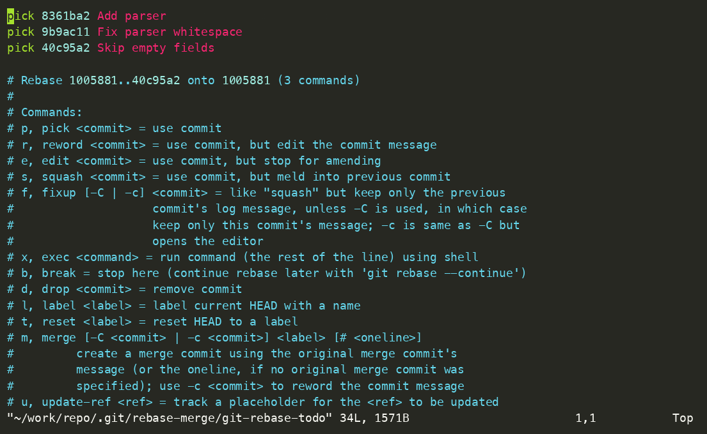

# tui-use

Let any AI agent drive interactive terminal programs: vim, `git rebase -i`, `npm init`, ssh, REPLs, debuggers, htop, installers and database shells.

Coding agents run shell commands one at a time, without a terminal. A command that waits for input hangs until the tool times out, a full-screen program prints escape codes, and a REPL forgets everything between turns. tui-use gives the agent a real terminal that it can read and type into across as many turns as it needs.

```
claude mcp add tui-use -- npx -y @pavanmanishd/tui-use@1.1.0 mcp
```



Claude Code (Opus) squashing three commits with `git rebase -i` through tui-use. It rewrites the todo list with `:2,3s/^pick/squash/`, replaces the combined commit message and saves. This is the terminal the agent drove, as tui-use recorded it.

## What the agent sees

Every call that changes something returns the screen as numbered text. The cursor is shown as `[x]`, and highlighted text, such as the selected item in a menu, is wrapped in `«…»`. When a row has highlights in more than one colour, the one that stands out most keeps `«…»` and the fainter ones get `‹…›`, so in a yes/no dialog you can tell which button is active. Three or more identical rows, such as vim's `~` filler, fold into one line that keeps the row numbers.

```
session s1 · git rebase -i HEAD~3 · 120x40 · cursor 2:1 · alt · running · idle 310ms
───
 1│pick 3f2a1c0 Add parser
 2│[s]quash 9b4e7d2 Fix parser edge case
 3│squash 1d8c5aa Rename parser module
 4│
 5│# Rebase 7c0e2b1..1d8c5aa onto 7c0e2b1 (3 commands)
 …
40│"~/repo/.git/rebase-merge/git-rebase-todo" 27L, 1189C
```

```
session s2 · vim notes.md · 120x40 · cursor 3:1 · alt · running · idle 305ms
───
 1│# Notes
 2│
 3│[-] buy milk
 4│~
…(rows 5-39 same as row 4)
40│"notes.md" 3L, 24B
```

After the first screen, `tui_send` returns only the rows that changed:

```
session s1 · python3 · 120x40 · cursor 6:5 · normal · running · idle 312ms
───
 4│>>> sum(x) * 2
 5│42
 6│>>> [ ]
(3 of 40 rows changed)
```

## Install

tui-use needs Node.js 22 or later on macOS or Linux. On Windows, use WSL. Prebuilt terminal binaries ship for x64 and arm64, so nothing is compiled during install.

### Claude Code

```
claude mcp add tui-use -- npx -y @pavanmanishd/tui-use@1.1.0 mcp
```

The plugin adds the same server plus a skill that tells Claude when to use tui-use instead of the shell:

```
/plugin install tui-use --marketplace pavanmanishd/tui-use
```

### Codex

`~/.codex/config.toml`:

```toml
[mcp_servers.tui-use]
command = "npx"
args = ["-y", "@pavanmanishd/tui-use@1.1.0", "mcp"]
```

### Cursor

`~/.cursor/mcp.json`:

```json
{
  "mcpServers": {
    "tui-use": { "command": "npx", "args": ["-y", "@pavanmanishd/tui-use@1.1.0", "mcp"] }
  }
}
```

### Gemini CLI

`~/.gemini/settings.json`:

```json
{
  "mcpServers": {
    "tui-use": { "command": "npx", "args": ["-y", "@pavanmanishd/tui-use@1.1.0", "mcp"] }
  }
}
```

### OpenCode

`opencode.json`:

```json
{
  "$schema": "https://opencode.ai/config.json",
  "mcp": {
    "tui-use": {
      "type": "local",
      "command": ["npx", "-y", "@pavanmanishd/tui-use@1.1.0", "mcp"],
      "enabled": true
    }
  }
}
```

### Claude Desktop

`claude_desktop_config.json`:

```json
{
  "mcpServers": {
    "tui-use": { "command": "npx", "args": ["-y", "@pavanmanishd/tui-use@1.1.0", "mcp"] }
  }
}
```

### Any agent with a shell

```
npm install -g @pavanmanishd/tui-use@1.1.0
tui-use start "npm init" --name init
tui-use send init --text "my-app" --key enter
```

## MCP tools

| Tool | What it does |
|---|---|
| `tui_start` | Starts a program and returns its first screen. Takes `command`, `cwd`, `env`, `cols`, `rows`, `name` and `wait`. |
| `tui_send` | Types `text`, a `secret_env` value and `keys` (or an ordered `input` list), waits, and returns the new screen as a diff by default. `paste: true` sends the text as a bracketed paste. |
| `tui_snapshot` | Returns the screen without sending input. `styles: "none"` drops the `«…»` marks, and `image: true` adds a PNG of the screen with its colours. |
| `tui_wait` | Waits without sending input, for builds and installs. |
| `tui_scrollback` | Reads output that scrolled off the screen, by line range (such as `[-50, -1]`) or by `search`. |
| `tui_manage` | Lists sessions, kills one (SIGTERM, then SIGKILL after 2 s), resizes one, or returns the path of its recording. |

Saving and quitting vim in one call:

```json
{ "session": "s1", "input": [{ "key": "esc" }, { "text": ":wq" }, { "key": "enter" }] }
```

Clicking and scrolling work in programs that turn on mouse input (htop, mc, lazygit and most TUI frameworks). Rows and columns are the ones shown in the snapshot:

```json
{ "session": "s1", "input": [{ "mouse": { "action": "click", "row": 12, "col": 5 } }] }
```

The actions are `click`, `double_click`, `right_click`, `middle_click`, `scroll_up` and `scroll_down`.

Key names are `enter`, `tab`, `esc`, `backspace`, `delete`, `up`, `down`, `left`, `right`, `home`, `end`, `pageup`, `pagedown`, `space`, `f1` to `f12` and any single character, optionally prefixed with `ctrl+`, `alt+` or `shift+` (for example `ctrl+c` or `shift+tab`). An unknown key name is an error, never typed as text.

### Waiting

By default, a call returns once the program has printed something and then stayed quiet for 300 ms with an unchanged screen, or after 5 seconds. If only a few characters on one row keep changing, as with a spinner or a percentage, the call returns after about half a second with a note naming that row. If more of the screen is still changing at the timeout, the response ends with a note saying so. For slow programs, pass a wait object:

| Field | Returns when |
|---|---|
| `text` | this substring is on screen |
| `regex` | this pattern matches the screen |
| `gone` | this substring has left the screen |
| `idle_ms` | there has been no output for this long |
| `exit` | the program exits |
| `timeout_ms` | the time limit is reached (default 5000, max 600000) |

Conditions combine with OR, and the response names the one that fired.

## CLI

The CLI offers the same operations to agents that only have a shell. Sessions live in a background daemon, so they survive between shell calls.

```
tui-use start "npm init" --name init
tui-use send init --text "my-app" --key enter
tui-use send init --input esc ":wq" enter
tui-use snapshot init --diff
tui-use wait init --text "Is this OK?" --timeout 10000
tui-use scrollback init --search error
tui-use list
tui-use kill init
tui-use attach init
tui-use screenshot init --out init.png
tui-use replay ~/.local/share/tui-use/recordings/20261121-101500-s1.cast
```

With `--input`, a token like `mouse:click:12:5` clicks at row 12, column 5. `--json` prints the raw response. Exit codes are 0 for success, 1 for a request error, 2 for a usage error and 3 when a wait times out. Quote commands that have their own flags, as in `tui-use start "git rebase -i HEAD~3"`.

## Watching or taking over

`tui-use attach <session>` mirrors a session in your terminal while the agent works. Anything you type goes to the program as well, and the agent's screen header shows `human attached (rw)` while you are attached. Press `ctrl+]` to detach; the session keeps running.

## Configuration

`~/.config/tui-use/config.json`, with every key optional:

```json
{
  "maxSessions": 8,
  "idleTimeoutMinutes": 30,
  "scrollbackLines": 10000,
  "recordings": true,
  "recordingRetentionDays": 7,
  "deny": ["^rm -rf /", "^sudo "]
}
```

`deny` is a list of regular expressions. A command that matches one is refused before anything runs. An unknown key stops the daemon from starting, so a typo can't be silently ignored.

## Security

- tui-use runs commands as you, with the environment of the agent that asked. It adds no privilege that the agent's shell tool didn't already have, and it is not a sandbox.
- One daemon per user listens on a unix socket in a directory only you can read. Clients refuse to connect if that directory is a symlink, belongs to another user, or is readable by other users.
- `secret_env` names an environment variable of the tui-use process, for example one set in your MCP config. Its value is typed into the program and replaced with `***` wherever it would appear in a screen, scrollback, search result or recording. List such variables in `TUI_USE_SECRETS` (for example `TUI_USE_SECRETS=SSH_PASS,DB_PASS`) so they are not copied into the environment of the programs tui-use starts.
- Sessions an MCP client starts are killed when that client disconnects. Other MCP clients can read them but cannot type into them.
- Every session is recorded as an asciinema v2 file under `~/.local/share/tui-use/recordings`. Recordings never contain input and are deleted after 7 days.

## Known limitations

- Highlight strength is judged by colour contrast against the screen's main background. A program that marks its active item with a dimmer colour than the inactive ones will show them the wrong way round; `image: true` on `tui_snapshot` shows the real colours.
- A spinner note means the call returned before the program finished. For slow programs, pass a `wait` with `text`, `regex` or `gone`.
- Screenshots use an 8x16 bitmap font that covers Latin, box drawing and block characters. Other scripts, such as CJK, are drawn as boxes in the image; the text snapshot shows them correctly.
- Redaction matches the exact secret. A program that prints it in altered form, such as masked or split by escape codes, is not caught.
- There is no native Windows support (WSL works).

## TUI-Bench

TUI-Bench is a set of 45 interactive tasks covering editors, git, prompts, REPLs, full-screen apps, ssh and pickers. Each task runs in a Docker container and is scored by a scripted checker. The runner drives real agent CLIs (Claude Code, Gemini CLI and OpenCode) twice per task, once with only the shell tool and once with tui-use added, and reports success rate, turns, tokens and wall time. See [bench/README.md](bench/README.md) to reproduce it.

### Results

**Locked-down tasks.** Five tasks take away the agent's usual ways to fake a terminal: no general sudo, and Python, Perl, `script`, compilers, terminal-capable editors, bundled pty modules and package downloads are all blocked for the agent user. Each task shows something on screen the agent has to read and answer. Claude Code 2.1.329 with tui-use 1.1, 3 repeats per cell (60 runs):

| Model | Shell only | With tui-use | Median turns (shell / tui-use) | Median tokens (shell / tui-use) | Median wall time (shell / tui-use) |
|---|---|---|---|---|---|
| Claude Opus 5.5 | 100% | 100% | 10 / 11 | 267k / 257k | 44 s / 32 s |
| Claude Haiku 5.5 | 53% | 100% | 13 / 16 | 359k / 383k | 80 s / 32 s |

- With tui-use, both models passed every run and used it in every run.
- Without it, Haiku failed every run of the quiz and the whiptail wizard and one of three ssh password-change runs.
- Opus still passed everything, because it builds a terminal from whatever is left. On the ssh tasks it used `SSH_ASKPASS` with `ssh -tt`. On the gdb task it swapped the program's `/dev/tty` handle for stdin from a batch script. For the quiz and the wizard it started its own sshd on a high port and drove `ssh -tt localhost` from a bash coprocess. An earlier run of these tasks also found the node-pty build inside gemini-cli and util-linux's `scriptlive`, which are now blocked too. Those workarounds took it about a third longer than tui-use did.

**All 40 original tasks**, Claude Code with tui-use 1.0, 3 repeats per cell (480 runs):

| Model | Shell only | With tui-use | Median turns (shell / tui-use) | Median tokens (shell / tui-use) | Median wall time (shell / tui-use) |
|---|---|---|---|---|---|
| Claude Opus 5.5 | 99% | 100% | 4 / 8 | 84k / 151k | 17 s / 20 s |
| Claude Haiku 5.5 | 99% | 100% | 4 / 5 | 90k / 114k | 15 s / 14 s |

- With Python in the image, Claude Code finished almost every task with only a shell. When a program needed a terminal (htop, ssh password prompts, whiptail, vimdiff), it usually wrote its own Python `pty.fork()` driver on the spot. Both failures were `htop-kill` runs without tui-use.
- With tui-use available, the agent chose it in 129 of 240 runs (Opus in 80 of 120, Haiku in 49 of 120), mostly for editors, prompts, pickers, full-screen apps and ssh. Those runs took more turns and tokens than the shell runs, because the agent reads the screen between steps instead of scripting blind.

A re-run of six of these tasks with tui-use 1.1 (36 runs) showed no measurable change in tokens per run despite the smaller snapshots. Among runs that used tui-use, the median moved from 171k to 182k for Opus and from 253k to 257k for Haiku, which is within run-to-run noise. Most of each run's tokens are the agent's own context, not screens.

OpenCode with DeepSeek V4.1 Flash, run through T3 Code on six interaction-heavy tasks with one repeat, passed all 12 runs in both conditions ([details](bench/results/delegated-opencode-2026-11-22/report.md)). Gemini CLI and the open-weight models in [bench/runner/matrix.json](bench/runner/matrix.json) have not been run yet; they need `GEMINI_API_KEY` and `OPENROUTER_API_KEY`.

Two caveats apply. The Claude runs used a Claude subscription token, so Claude Code inside the containers also loaded that account's organization policy, equally in both conditions. And a single repeat for the OpenCode batch is too few to separate small differences. The raw results are in [bench/results](bench/results).

## Compared with other tools

Based on each project's README in November 2026.

| | tui-use | terminal-use (`tu`) | mcp-interactive-terminal | pexpect-mcp | tmux MCP servers |
|---|---|---|---|---|---|
| MCP server | yes | no, CLI only | yes | yes | yes |
| CLI for agents with only a shell | yes | yes | no | no | no |
| Terminal emulator | xterm.js | alacritty | xterm.js | none (pexpect) | tmux |
| Input, wait and new screen in one call | yes | no, separate commands | yes | not documented | varies |
| Diff of changed rows | yes | not documented | not documented | no | not documented |
| Selected items marked in text | yes | not documented | not documented | no | not documented |
| Secrets kept out of output | yes | not documented | not documented | not documented | not documented |
| Human can watch live | yes, and type | yes, watch only | not documented | not documented | yes (tmux attach) |
| Mouse input | yes | yes | not documented | not documented | not documented |
| Screenshots | PNG | PNG | not documented | not documented | not documented |
| Recordings | asciinema | not documented | not documented | not documented | not documented |
| Benchmark | TUI-Bench | no | no | no | no |

## Development

```
npm ci
npm run lint && npm run typecheck
npm test                  # unit tests
npm run test:integration  # real programs in real terminals; the ssh test needs Docker
```

## Releasing

Bump the version in `package.json`, `server.json` and the plugin, merge to `main`, and push a `vX.Y.Z` tag. The release workflow runs the tests, publishes to npm through trusted publishing, creates the GitHub release and updates the MCP registry entry.

## License

Apache-2.0. See [LICENSE](LICENSE) and [NOTICE](NOTICE).
